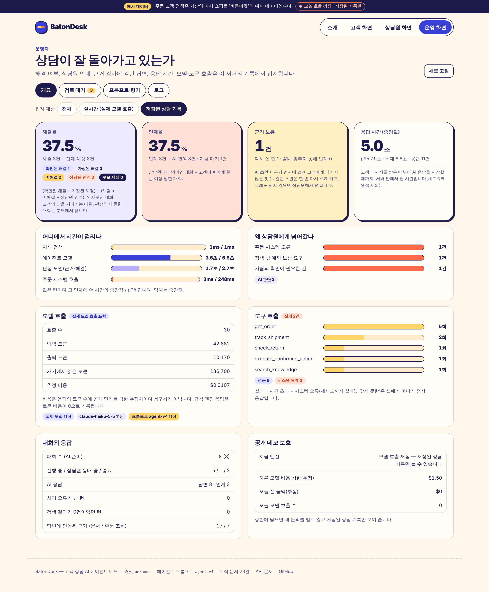
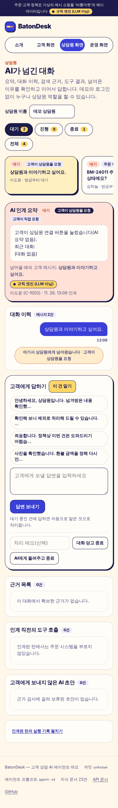

# BatonDesk

**근거로 답하고, 모르면 멈추고, 맥락째 상담원에게 넘기는 고객 상담 AI 에이전트.**

> 주문·고객·정책은 가상의 예시 쇼핑몰 "바통마켓"의 **예시 데이터**입니다. 실제 고객 정보나 주문 시스템을 쓰지 않습니다.


## 현재 상태 — 먼저 읽어 주세요

| 항목 | 상태 |
|---|---|
| 백엔드, 에이전트 그래프, 판정 API, 예시 주문 시스템 | 구현. 테스트 148건 통과(모델 대역 사용) |
| 화면(고객·상담원·운영·위젯) | 구현. 브라우저 점검 148항목 통과(PC 1440×900, 모바일 390×844) |
| 실제 모델 평가 | **실행함.** `claude-haiku-5-5`, GitHub Actions. 평가 실행 25건(개발용 20, 평가용 5), 모델 호출 6,547회, 추정 비용 합계 약 2.4달러. 원자료가 `eval_results/runs/` 에 있음 |
| 프롬프트 버전 비교 | **실행함.** 에이전트 v1~v4, 근거 판정 v1~v4 를 같은 문항으로 비교. **평가용에서 v4 는 v1 보다 통과율이 높지 않았다**(아래) |
| CI | GitHub Actions 에서 실행 중: 단위 테스트·화면 점검·이미지 빌드, 프롬프트·에이전트가 바뀌면 실제 모델 평가와 회귀 게이트 |
| 실제 모델이 만든 저장 상담 기록 | 8건 (`data/recordings/`). 키 없이 뜬 서버에서도 읽기 전용으로 볼 수 있음 |
| **공개 데모** | **아직 배포되지 않음.** `Dockerfile` 과 `render.yaml` 은 준비되어 있고 CI 가 이미지를 빌드해 띄워 본다. 배포는 저장소 주인이 Render 계정을 연결해야 한다(아래 "배포") |
| 사람 검수, 실제 사용자 평가 | **없음.** 문항·정답·채점 규칙·실패 분류를 모두 AI가 했다 |

못 한 것의 전체 목록은 [docs/limitations.md](docs/limitations.md), 누가 무엇을 했는지는 [docs/how-this-was-built.md](docs/how-this-was-built.md) 에 있습니다.

## 무엇을 하는가

고객이 주문·배송·취소·반품·환불을 물으면:

1. 대화 맥락을 확인하고 지식 문서를 검색합니다.
2. 필요하면 허용된 도구로 예시 주문 시스템을 조회합니다.
3. 근거에 있는 내용으로 답하고 출처를 보여 줍니다.
4. 답이 근거와 어긋나면 고객에게 내보내지 않고 다시 씁니다. 그래도 안 되면 멈춥니다.
5. 해결할 수 없거나 사람의 판단이 필요하면 대화·근거·도구 결과·사유를 묶어 상담원에게 넘깁니다.
6. 상담원은 넘겨받은 내용을 보고 이어서 답합니다.
7. 운영자는 해결률·인계율·걸러진 답변·응답 시간·도구 오류를 봅니다.

**실제 모델로 만든 상담 기록** (모델 `claude-haiku-5-5`, 프롬프트 agent-v4, 커밋 `f22724e`. 고객 메시지는 스크립트에 정해 둔 글)

| 고객 화면 — 답변, 출처, 고객에게 보내지 않은 초안 | 상담원 화면 — AI가 넘긴 요약·대화·근거·도구 결과 |
|---|---|
|  |  |

| 운영 화면 — 해결·인계·근거 보류·지연·모델/도구 호출 | 운영 화면 — 프롬프트 버전별 평가 결과 |
|---|---|
|  |  |

왼쪽 위 화면의 붉은 상자가 근거 검사에 걸려 고객에게 나가지 않은 초안이다("국내 배송 기준"이라는 말이 근거에 없었다). 모델은 그 문장을 빼고 다시 썼다.

**규칙 엔진(LLM 아님)으로 띄운 서버** — 대화를 직접 해 보는 흐름과 오류 상태. 화면 상단 배지에 "규칙 엔진 (LLM 아님)"이라고 표시된다.

| 고객 화면 — 답변과 출처 | 주문 시스템 장애 → 인계 |
|---|---|
|  |  |

| 모바일 — 상담원 대기 목록 | 모바일 — 실제 모델 기록 |
|---|---|
|  |  |

## 설계에서 지키려 한 것

- **틀린 답이 나가는 경로를 없앤다.** 고객에게 보이는 글은 근거 검사를 지난 답이거나, 시스템이 만든 정해진 인계 문구뿐입니다. → `src/batondesk/agent/graph.py`
- **안전장치는 프롬프트가 아니라 코드에 둔다.** 도구 허용 목록, 대화에 묶인 고객의 주문만 조회, 취소·반품은 확인 코드를 받은 다음 턴에만 실행. → `src/batondesk/tools/executor.py`
- **판정기도 틀린다고 전제한다.** 근거 판정기와 해결 판정기를 라벨된 자료로 따로 평가하고, 누가(어느 모델·프롬프트 버전) 판정했는지 결과에 남깁니다. → `src/batondesk/checks/`, `docs/evaluation.md`
- **무엇이 진짜인지 화면에서 구분한다.** 실제 모델 호출 / 저장된 상담 기록 / 예시 주문 시스템 / 규칙 엔진을 배지로 표시합니다.
- **없는 숫자를 쓰지 않고, 안 좋은 숫자도 적는다.** 프롬프트 개선이 평가용에서 효과가 없었던 것, 채점 규칙이 틀렸던 것, 진단이 틀렸던 것을 그대로 남겼습니다.

## 측정된 것

**실제 모델** — `claude-haiku-5-5`(에이전트·판정 모두, effort low), GitHub Actions ubuntu-24.04, 2026-11-26. 평가용은 고치는 동안 보지 않은 자료이고, 두 구성을 같은 커밋에서 3회씩 돌렸다.

| 무엇 | 기준선 (v1 프롬프트) | 최종 (v4 프롬프트) | 자료 |
|---|---:|---:|---|
| 에이전트 통과율 | 89.1% [81.8, 95.3] | 89.6% [82.8, 95.3] | 평가용 64문항 × 3회 |
| ↳ 같은 문항끼리의 차이 | | **+0.5%p [−3.6, +5.2]** | 차이가 있다고 말할 수 없음 |
| ↳ 채점 오류 4문항을 고친 뒤 재채점 | 92.2% | 92.7% | 수정 전후를 모두 남김 |
| 인계 재현율 / 과잉 인계 | 97.0% / 0.9% | 97.0% / 3.4% | |
| 주입한 틀린 초안 차단 (재채점) | 18/18 | 18/18 | |
| 턴 지연 p50 / p95 | 6.6초 / 15.0초 | 5.5초 / 10.0초 | 225턴 |
| 추정 비용 | $0.267 | $0.227 | 192회 대화 실행 전체. 토큰 수 × 공개 단가 |
| 근거 판정기: 어긋난 답을 잡음 / 멀쩡한 답을 통과 | 78/78 / 80/84 | 78/78 / 77/84 | 평가용 54문항 × 3회 |
| 해결 판정기: 5분류 정확도 | 97.2% [91.7, 100] | (같은 프롬프트) | 평가용 36문항 × 3회 |

- **프롬프트를 네 번 고쳤지만 평가용 통과율은 오르지 않았다.** 개발용에서 보인 차이(94.2% → 97.5%)가 재현되지 않았다. v4 를 기본으로 올린 이유는 같은 통과율에서 지연과 비용이 낮아서다.
- 통과율을 움직인 것은 프롬프트 밖이었다: 판정기에 상담 정보(시각·고객 이름)를 주고, 실패한 도구 호출을 근거로 남기고, 검색이 공지의 일부만 가져오던 것을 고친 뒤 같은 v1 프롬프트의 개발용 통과율이 89~91% → 94.2% 가 되었다.
- 평가용 64문항 중 2문항에서 **틀리거나 빠진 정책 답이 고객에게 나갔다**(두 구성 모두, 3회 다). 원인은 검색이고 근거 검사는 이것을 잡지 못한다.
- 턴 하나에 5~6초가 걸린다. 채팅 상담으로는 느리다.

**모델 호출 없음**

| 무엇 | 결과 | 조건 |
|---|---|---|
| 검색: 5위 안에 정답 청크 | 77.5% (융합) · 67.5% (BM25만) · 72.5% (문자 n-gram만) | 평가용 40문항, AI가 쓴 질의 |
| 유의어 확장의 효과 | 개발용 75% → 90%, **평가용 77.5% → 77.5%** | 개발용 실패에 맞춘 사전이 일반화되지 않음 |
| 규칙만으로 어긋난 답 탐지 | 재현율 30.8% (8/26), 특이도 92.9% (26/28) | 평가용 54문항. LLM 판정이 필요한 이유 |
| 무행동 정책의 채점 통과율 | 항상 인계 25.9% · 항상 "모름" 13.8% · 항상 되묻기 1.7% | 평가용 58문항. 채점이 느슨하지 않은지 확인 |
| 서버 상주 메모리 | 393MB (조정 전 576MB) | 로컬, 규칙 엔진으로 3턴 뒤 최대값 |

구간·분류별 결과·실패 문항·채점 오류·프롬프트 버전별 변경 이유는 [docs/evaluation.md](docs/evaluation.md).
모든 문항과 정답은 AI가 썼고 사람이 검수하지 않았다. 실제 사용자 평가는 받지 않았다.

## 실행

```bash
python -m venv .venv && . .venv/bin/activate
pip install -e ".[dev]"

BATONDESK_LLM_MODE=scripted batondesk serve     # 규칙 엔진(LLM 아님) — 대화 흐름을 직접 해 볼 수 있다
batondesk serve                                 # 키 없음: 모델 호출 꺼짐, 실제 모델로 만든 저장 기록 8건을 읽기 전용으로
ANTHROPIC_API_KEY=… batondesk serve             # 실제 모델
```

<http://localhost:8000> → 고객 화면(`/chat`) → 상담원 화면(`/desk`) → 운영 화면(`/ops`). API 문서는 `/docs`.

```bash
pytest                                             # 테스트 148건
tests/e2e/run.sh                                   # 브라우저 화면 점검 148항목(서버 3종)
python -m batondesk.evals retrieval --split test   # 검색 평가
docker build -t batondesk . && docker run -p 8000:8000 batondesk
```

## 배포

**아직 배포되지 않았다.** 이 저장소를 만든 작업 환경에서는 호스팅 계정을 만들 수 없어, 배포는 저장소 주인이 해야 한다.
`render.yaml` 과 `Dockerfile` 로 Render 무료 웹 서비스 한 개에 올린다. CI 가 같은 이미지를 빌드해 컨테이너로 띄우고 상태 확인을 통과하는지 본다.

1. <https://render.com/deploy?repo=https://github.com/sokldjs554/batondesk> 을 열어 저장소를 Blueprint 로 연결한다.
2. `ANTHROPIC_API_KEY` 를 입력한다. 비워 두면 서버는 "모델 호출 꺼짐"으로 뜨고 저장된 상담 기록만 보여 준다.
3. 배포가 끝나면 저장소 변수 `PUBLIC_DEMO_URL`(Settings → Secrets and variables → Actions → Variables)에 공개 주소를 넣는다.
   그 뒤로는 push 마다 `live-gate` 워크플로가 공개 주소가 그 커밋을 서빙하는지 확인한다.

공개 데모는 하루 모델 호출 추정 비용 상한(기본 1.5달러)과 시간당 요청 수 상한이 걸려 있고, 넘으면 새 문의를 받지 않는다.

## 구성

```
src/batondesk/
  agent/      한 턴의 그래프(LangGraph), 출력 형식, 근거 등록부
  tools/      도구 정의(허용 목록), 실행기, 주문 시스템 클라이언트
  checks/     근거 일치 판정(규칙 + LLM), 해결 여부 판정
  kb/         지식 검색(형태소 BM25 + 문자 n-gram, RRF)
  commerce/   예시 주문 시스템(별도 ASGI 앱, 장애 재현)
  llm/        Claude 호출, 테스트 대역
  prompts/    프롬프트 버전 저장소
  evals/      평가 실행기, 채점, 통계
  api/ obs/ store/ service.py
kb/           지식 문서 23건        prompts/   프롬프트 버전 + 잠금
data/evals/   평가 자료 307문항     web/       화면
data/recordings/  실제 모델로 만든 상담 기록 8건     eval_results/  평가 실행 원자료 25건
```

`FastAPI` · `LangGraph` · `Anthropic SDK` · `Kiwi` · `SQLite` · `pytest` · `Playwright` · `GitHub Actions` · `Docker`

## 문서

| 문서 | 내용 |
|---|---|
| [공고 대조표](docs/job-posting-map.md) | 공고의 업무·자격·우대 항목별 구현 여부와 근거 |
| [구조와 상담 흐름](docs/architecture.md) | 7단계 흐름, 그래프, 핵심 코드 위치, 데이터 구분 |
| [설계 결정](docs/design-decisions.md) | 고른 것과 버린 것, 쓴 기술과 검토만 한 기술 |
| [평가](docs/evaluation.md) | 자료, 채점 기준, 프롬프트 버전 비교, 평가용 결과와 실패 읽기, 한계 |
| [API 설명](docs/api.md) | 엔드포인트 표(코드에서 생성), 사용 예 |
| [테스트 방법](docs/testing.md) | 무엇을 어떻게 확인하는가 |
| [조사 기록](docs/research.md) | 국내외 상담 제품, 지표 정의, 참고한 화면과 이유 |
| [재사용 범위](docs/reuse.md) | 기존 저장소 조사, 가져온 코드와 바꾼 점 |
| [한계](docs/limitations.md) | 하지 못한 것 |
| [만들어진 방식](docs/how-this-was-built.md) | 누가 무엇을 했나, 재현 체크리스트 |
| [변경 기록](CHANGELOG.md) | |
