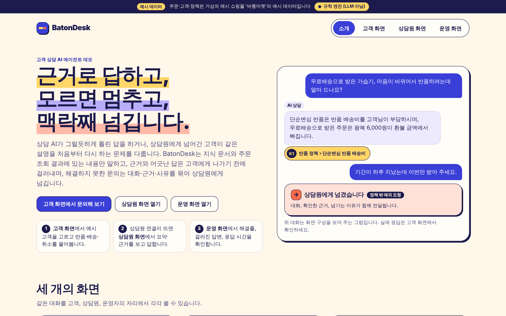
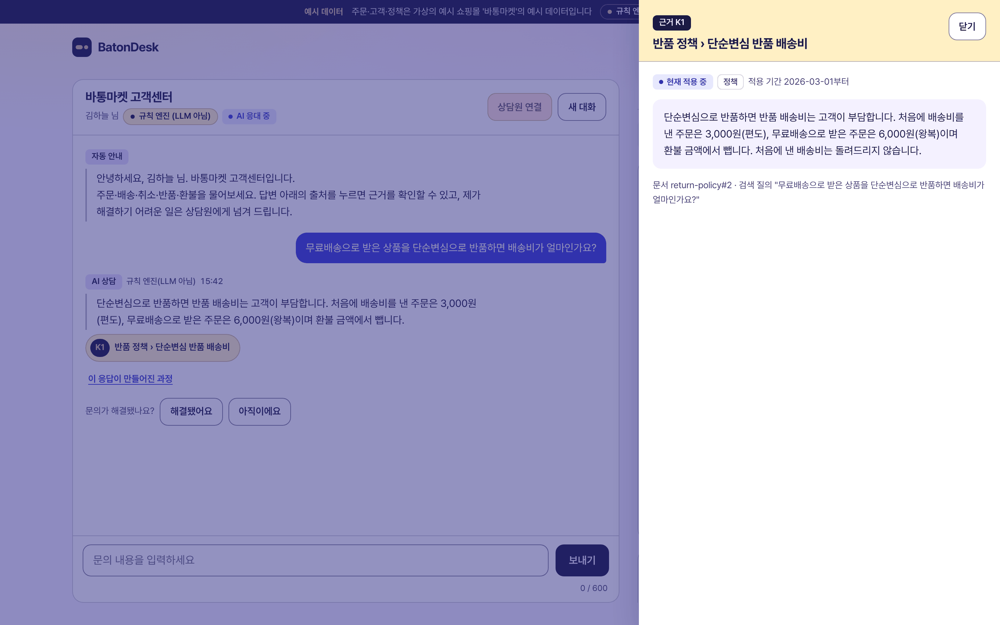
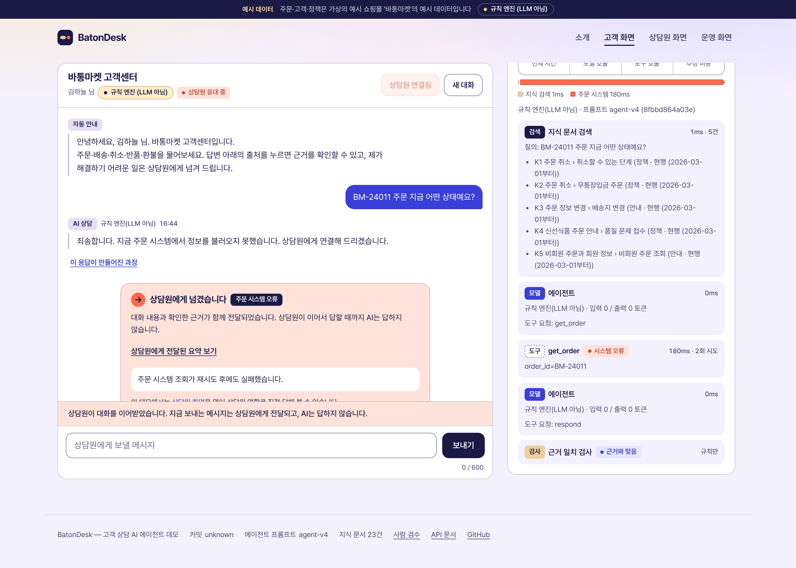
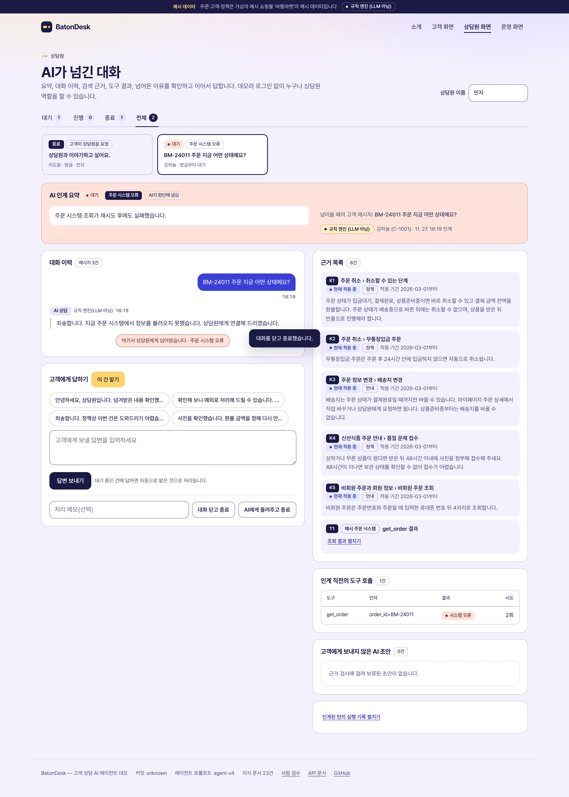
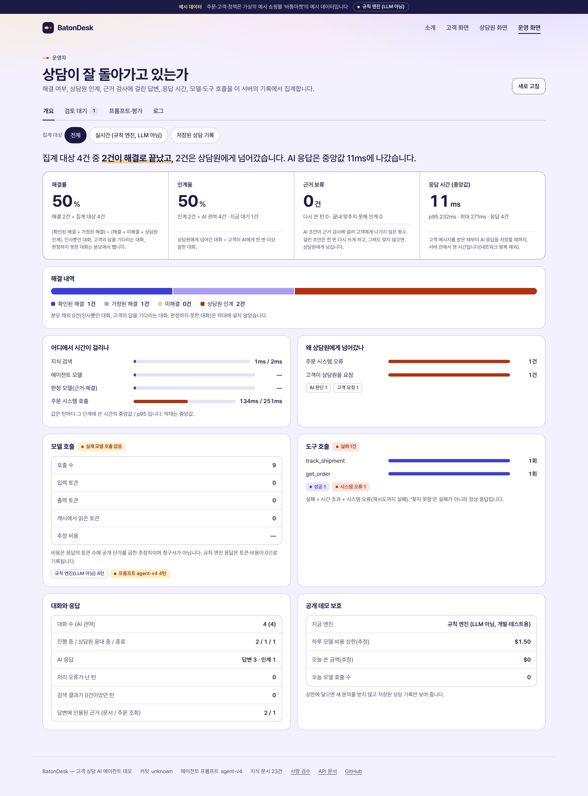

# BatonDesk

**근거로 답하고, 모르면 멈추고, 맥락째 상담원에게 넘기는 고객 상담 AI 에이전트.**

> 주문·고객·정책은 가상의 예시 쇼핑몰 "바통마켓"의 **예시 데이터**입니다. 실제 고객 정보나 주문 시스템을 쓰지 않습니다.



## 현재 상태 — 먼저 읽어 주세요

이 저장소는 **코드·평가 자료·화면·문서는 갖췄지만, 실제 모델로 돌린 결과가 아직 없습니다.**
API 키가 GitHub Actions 시크릿에만 있는데, 작업 당시 저장소로의 push 가 막혀 워크플로를 실행하지 못했습니다.

| 항목 | 상태 |
|---|---|
| 백엔드, 에이전트 그래프, 판정 API, 예시 주문 시스템 | 구현. 테스트 144건 통과(모델 대역 사용) |
| 화면(고객·상담원·운영·위젯) | 구현. 브라우저 점검 118항목 통과(PC 1440×900, 모바일 390×844, 규칙 엔진) |
| 검색 품질 | **측정됨**: 평가용 40문항에서 5위 내 적중 77.5% |
| 평가 자료(284문항)와 실행기 | 준비됨. 평가용 동결 |
| **실제 모델 평가**(답변 품질, 인계 판단, 판정기 정확도, 지연·비용) | **실행 전 — 숫자 없음** |
| **프롬프트 버전 비교** | **실행 전** — 버전이 v1 하나뿐 |
| **CI 실행 기록** | **없음** — 워크플로 파일만 있음 |
| **공개 데모** | **배포 전** — `Dockerfile`, `render.yaml` 만 있음 |
| 실제 모델이 만든 저장 상담 기록 | 없음 |

무엇을 하면 채워지는지는 [docs/how-this-was-built.md](docs/how-this-was-built.md) 의 체크리스트에, 못 한 것의 전체 목록은 [docs/limitations.md](docs/limitations.md) 에 있습니다.

## 무엇을 하는가

고객이 주문·배송·취소·반품·환불을 물으면:

1. 대화 맥락을 확인하고 지식 문서를 검색합니다.
2. 필요하면 허용된 도구로 예시 주문 시스템을 조회합니다.
3. 근거에 있는 내용으로 답하고 출처를 보여 줍니다.
4. 답이 근거와 어긋나면 고객에게 내보내지 않고 다시 씁니다. 그래도 안 되면 멈춥니다.
5. 해결할 수 없거나 사람의 판단이 필요하면 대화·근거·도구 결과·사유를 묶어 상담원에게 넘깁니다.
6. 상담원은 넘겨받은 내용을 보고 이어서 답합니다.
7. 운영자는 해결률·인계율·걸러진 답변·응답 시간·도구 오류를 봅니다.

| 고객 화면 — 답변과 출처 | 주문 시스템 장애 → 인계 |
|---|---|
|  |  |

| 상담원 화면 — 요약·근거·도구 결과 | 운영 화면 — 지표와 정의 |
|---|---|
|  |  |

캡처는 **규칙 엔진(LLM 아님)** 으로 띄운 서버에서 찍었습니다. 화면 상단 배지에 그렇게 표시되어 있습니다. 실제 모델 응답의 캡처는 아직 없습니다.

## 설계에서 지키려 한 것

- **틀린 답이 나가는 경로를 없앤다.** 고객에게 보이는 글은 근거 검사를 지난 답이거나, 시스템이 만든 정해진 인계 문구뿐입니다. → `src/batondesk/agent/graph.py`
- **안전장치는 프롬프트가 아니라 코드에 둔다.** 도구 허용 목록, 대화에 묶인 고객의 주문만 조회, 취소·반품은 확인 코드를 받은 다음 턴에만 실행. → `src/batondesk/tools/executor.py`
- **판정기도 틀린다고 전제한다.** 근거 판정기와 해결 판정기를 라벨된 자료로 따로 평가하고, 누가(어느 모델·프롬프트 버전) 판정했는지 결과에 남깁니다. → `src/batondesk/checks/`, `docs/evaluation.md`
- **무엇이 진짜인지 화면에서 구분한다.** 실제 모델 호출 / 저장된 상담 기록 / 예시 주문 시스템 / 규칙 엔진을 배지로 표시합니다.
- **없는 숫자를 쓰지 않는다.** 측정하지 못한 것은 빈칸으로 둡니다.

## 측정된 것 (모델 호출 없음)

| 무엇 | 결과 | 조건 |
|---|---|---|
| 검색: 5위 안에 정답 청크 | 77.5% (융합) · 67.5% (BM25만) · 72.5% (문자 n-gram만) | 평가용 40문항, AI가 쓴 질의 |
| 유의어 확장의 효과 | 개발용 75% → 90%, **평가용 77.5% → 77.5%** | 개발용 실패에 맞춘 사전이 일반화되지 않음 |
| 규칙만으로 어긋난 답 탐지 | 재현율 30% (6/20), 특이도 85% (17/20) | 평가용 40문항. LLM 판정이 필요한 이유 |
| 무행동 정책의 채점 통과율 | 항상 인계 25.9% · 항상 "모름" 17.2% · 항상 되묻기 3.4% | 평가용 58문항. 채점이 느슨하지 않은지 확인 |
| 서버 상주 메모리 | 393MB (조정 전 576MB) | 로컬, 규칙 엔진으로 3턴 뒤 최대값 |

자세한 내용과 한계는 [docs/evaluation.md](docs/evaluation.md).

## 실행

```bash
python -m venv .venv && . .venv/bin/activate
pip install -e ".[dev]"

BATONDESK_LLM_MODE=scripted batondesk serve     # 규칙 엔진(LLM 아님) — 화면과 흐름을 볼 수 있다
ANTHROPIC_API_KEY=… batondesk serve             # 실제 모델
```

<http://localhost:8000> → 고객 화면(`/chat`) → 상담원 화면(`/desk`) → 운영 화면(`/ops`). API 문서는 `/docs`.

```bash
pytest                                             # 테스트 144건
tests/e2e/run.sh                                   # 브라우저 화면 점검
python -m batondesk.evals retrieval --split test   # 검색 평가
docker build -t batondesk . && docker run -p 8000:8000 batondesk
```

## 배포

`render.yaml` 과 `Dockerfile` 로 Render 무료 웹 서비스 한 개에 올린다.

1. <https://render.com/deploy?repo=https://github.com/sokldjs554/batondesk> 을 열어 저장소를 Blueprint 로 연결한다.
2. `ANTHROPIC_API_KEY` 를 입력한다. 비워 두면 서버는 "모델 호출 꺼짐"으로 뜨고 저장된 상담 기록만 보여 준다.
3. 배포가 끝나면 저장소 변수 `PUBLIC_DEMO_URL`(Settings → Secrets and variables → Actions → Variables)에 공개 주소를 넣는다.
   그 뒤로는 push 마다 `live-gate` 워크플로가 공개 주소가 그 커밋을 서빙하는지 확인한다.

공개 데모는 하루 모델 호출 추정 비용 상한(기본 1.5달러)과 시간당 요청 수 상한이 걸려 있고, 넘으면 새 문의를 받지 않는다.

## 구성

```
src/batondesk/
  agent/      한 턴의 그래프(LangGraph), 출력 형식, 근거 등록부
  tools/      도구 정의(허용 목록), 실행기, 주문 시스템 클라이언트
  checks/     근거 일치 판정(규칙 + LLM), 해결 여부 판정
  kb/         지식 검색(형태소 BM25 + 문자 n-gram, RRF)
  commerce/   예시 주문 시스템(별도 ASGI 앱, 장애 재현)
  llm/        Claude 호출, 테스트 대역
  prompts/    프롬프트 버전 저장소
  evals/      평가 실행기, 채점, 통계
  api/ obs/ store/ service.py
kb/           지식 문서 23건        prompts/   프롬프트 버전 + 잠금
data/evals/   평가 자료 284문항     web/       화면
```

`FastAPI` · `LangGraph` · `Anthropic SDK` · `Kiwi` · `SQLite` · `pytest` · `Playwright` · `GitHub Actions` · `Docker`

## 문서

| 문서 | 내용 |
|---|---|
| [공고 대조표](docs/job-posting-map.md) | 공고의 업무·자격·우대 항목별 구현 여부와 근거 |
| [구조와 상담 흐름](docs/architecture.md) | 7단계 흐름, 그래프, 핵심 코드 위치, 데이터 구분 |
| [설계 결정](docs/design-decisions.md) | 고른 것과 버린 것, 쓴 기술과 검토만 한 기술 |
| [평가](docs/evaluation.md) | 자료, 채점 기준, 측정된 것과 아직 없는 것, 실행 방법 |
| [API 설명](docs/api.md) | 엔드포인트 표(코드에서 생성), 사용 예 |
| [테스트 방법](docs/testing.md) | 무엇을 어떻게 확인하는가 |
| [조사 기록](docs/research.md) | 국내외 상담 제품, 지표 정의, 참고한 화면과 이유 |
| [재사용 범위](docs/reuse.md) | 기존 저장소 조사, 가져온 코드와 바꾼 점 |
| [한계](docs/limitations.md) | 하지 못한 것 |
| [만들어진 방식](docs/how-this-was-built.md) | 누가 무엇을 했나, 재현 체크리스트 |
| [변경 기록](CHANGELOG.md) | |
