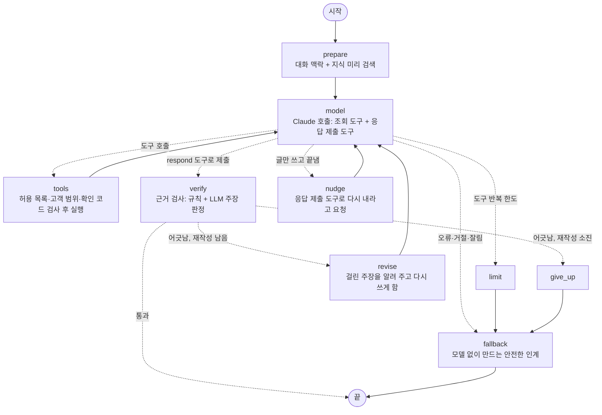

# 구조와 상담 흐름

> 모든 주문·고객·정책 데이터는 가상의 예시 쇼핑몰 "바통마켓"의 **예시 데이터**입니다.

## 상담 흐름

| # | 단계 | 무슨 일이 일어나는가 | 코드 |
|---|---|---|---|
| 1 | 고객이 질문한다 | 웹 채팅·임베드 위젯·API·웹훅으로 메시지가 들어온다 | `api/routers/conversations.py`, `api/routers/ops.py`(웹훅) |
| 2 | 맥락 확인과 지식 검색 | 이전 대화와 앞서 확보한 근거를 모으고, 메시지로 지식 문서를 미리 검색한다. 후속 질문이면 앞 메시지를 붙인 질의도 함께 검색한다 | `agent/graph.py` `prepare`, `kb/retriever.py` |
| 3 | 도구 호출 | 모델이 허용된 도구(주문 조회·배송 조회·취소/반품 확인·추가 검색)를 부른다. 실행기는 허용 목록·고객 범위·확인 코드를 검사한다 | `agent/graph.py` `model`·`tools`, `tools/executor.py` |
| 4 | 근거 있는 답변과 출처 | 모델이 `respond` 도구로 답과 인용한 근거 ID를 제출한다. 근거 검사를 통과하면 고객에게 나간다 | `agent/protocol.py`, `checks/grounding.py`, `agent/graph.py` `verify` |
| 5 | 보류와 인계 | 근거와 어긋나면 내보내지 않고 다시 쓰게 한다. 또 어긋나거나, 모델이 인계를 고르거나, 처리 중 오류가 나면 인계 티켓을 만든다 | `agent/graph.py` `revise`·`fallback`, `service.py` `_open_handoff` |
| 6 | 상담원 확인 | 상담원 화면에서 인계 요약, 대화, 근거, 도구 결과, 보내지 않은 AI 초안을 보고 답한다 | `api/routers/handoffs.py`, `web/desk.html` |
| 7 | 운영 확인 | 해결률·인계율·근거 보류·지연 시간·모델 호출·도구 실패를 본다 | `obs/metrics.py`, `api/routers/ops.py`, `web/ops.html` |

## 한 턴의 그래프

`src/batondesk/agent/graph.py` 의 실제 그래프다(`graph.get_graph().draw_mermaid()` 출력에서 옮김).



고객에게 나가는 글은 `verify` 를 지난 `respond` 제출이거나 `fallback` 이 만든 정해진 문구뿐이다. 도구 없이 쓴 글은 나가지 않는다.

## 구성 요소

```
브라우저 (web/)                         외부 채널
 ├ /chat   고객 채팅 + 데모 제어          └ POST /v1/channels/webhook
 ├ /desk   상담원 화면
 ├ /ops    운영 화면
 └ widget.js 임베드 위젯
        │ HTTP · SSE
        ▼
FastAPI 앱 (src/batondesk/api)
 ├ 대화 API ─────────────┐
 ├ 인계 API              │
 ├ 지식 검색 API          ▼
 ├ 판정 API ──▶ SupportService (service.py)
 └ 운영·데모 API           │
                          ├─▶ 에이전트 그래프 (agent/graph.py, LangGraph)
                          │     ├─▶ Claude API (llm/anthropic_llm.py)
                          │     ├─▶ 지식 검색 (kb/: 형태소 BM25 + 문자 n-gram, RRF)
                          │     ├─▶ 도구 실행기 (tools/) ──HTTP──▶ 예시 주문 시스템 (commerce/, 별도 ASGI 앱)
                          │     └─▶ 근거 판정기 (checks/grounding.py)
                          ├─▶ 해결 판정기 (checks/resolution.py)
                          └─▶ 저장소 (store/: SQLite — 대화·메시지·턴·인계·이벤트·비용 장부)
```

- **예시 주문 시스템**은 같은 프로세스에 있지만 별도 ASGI 앱이고, 도구는 HTTP 클라이언트로 호출한다. 제한 시간·재시도·오류 응답이 실제 HTTP 경계에서 일어난다. `BATONDESK_COMMERCE_URL` 을 주면 다른 서버를 부른다.
- **판정기**(근거 일치, 해결 여부)는 에이전트와 무관하게 `POST /v1/checks/grounding`, `POST /v1/checks/resolution` 으로 단독 호출할 수 있다.

## 핵심 코드 위치

| 주제 | 파일 |
|---|---|
| 한 턴의 흐름(그래프) | `src/batondesk/agent/graph.py` |
| 출력 형식, 인계 사유 값 | `src/batondesk/agent/protocol.py` |
| 근거 등록부(K·T ID) | `src/batondesk/agent/evidence.py` |
| 도구 정의(허용 목록) | `src/batondesk/tools/specs.py` |
| 도구 실행기(고객 범위, 확인 코드) | `src/batondesk/tools/executor.py` |
| 주문 시스템 클라이언트(제한 시간, 재시도) | `src/batondesk/tools/client.py` |
| Claude 호출(캐시, strict 도구, 구조화 출력, 재시도) | `src/batondesk/llm/anthropic_llm.py` |
| 근거 일치 판정 | `src/batondesk/checks/grounding.py`, `checks/facts.py` |
| 해결 여부 판정 | `src/batondesk/checks/resolution.py` |
| 지식 검색 | `src/batondesk/kb/retriever.py`, `bm25.py`, `charngram.py`, `tokenizer.py` |
| 예시 주문 시스템 | `src/batondesk/commerce/app.py`, `store.py`, `policy.py` |
| 대화·인계·피드백 처리 | `src/batondesk/service.py` |
| 운영 지표 | `src/batondesk/obs/metrics.py` |
| 프롬프트 버전 저장소 | `src/batondesk/prompts/registry.py`, `prompts/` |
| 평가 실행기·채점·통계 | `src/batondesk/evals/` |
| CI·실제 모델 평가 | `.github/workflows/ci.yml`, `eval-live.yml` |

## 데이터 구분

화면과 API는 세 가지를 구분해 표시한다.

| 구분 | 무엇인가 | 표시되는 곳 |
|---|---|---|
| 실제 모델 호출 | 이 서버가 지금 Claude API를 불러 만든 응답 | 화면 상단의 엔진 배지, `GET /v1/release` 의 `engine`, 대화의 `source: live` |
| 저장된 상담 기록 | GitHub Actions에서 실제 모델로 만들어 저장소에 넣어 둔 대화. 읽기 전용이고, 만든 날짜·모델·프롬프트 버전·커밋·실행 링크가 붙어 있다 | 대화의 `source: recorded`, `meta.provenance` |
| 예시 주문 시스템 | 가상의 주문 데이터와 API. 실제 결제·주문과 연결되지 않는다 | 근거의 "예시 주문 시스템" 표시, 응답 헤더 `X-Example-System: true` |

키 없이 화면을 개발할 때 쓰는 **규칙 엔진**은 LLM이 아니며, 그 모드에서는 화면에 "규칙 엔진 (LLM 아님)"이 표시되고 대화의 `source` 가 `rule-engine` 이다. 품질 수치에 섞이지 않는다.
